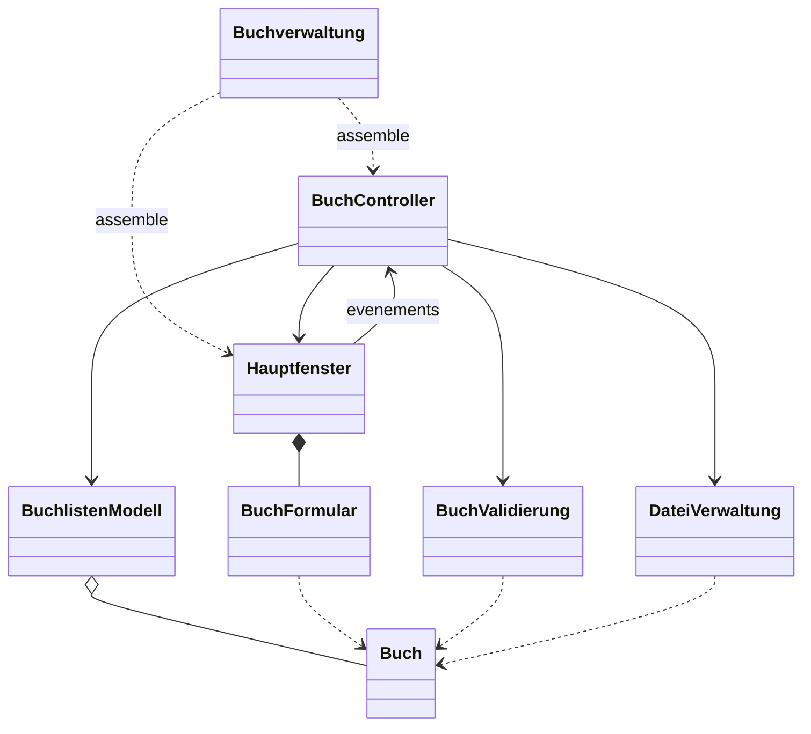

# Buchverwaltung — squelette Java Swing

Ouvrir **Buchverwaeltung** dans Apache NetBeans. Le projet cible Java 21 et utilise UTF-8.
Le dossier `mavenproject1` est un ancien exemple « Hello World », conserve mais hors de l'application.

Ce livrable definit l'architecture et les signatures, sans implementer les fonctionnalites.
Les methodes `TODO` levent `UnsupportedOperationException` : le code compile, mais l'application
n'est pas encore utilisable. Les attributs, constructeur et accesseurs existants de `Buch`
sont conserves. Les anciennes operations de liste sont maintenant des points a completer.

## Structure et responsabilites

| Package / classe | Role |
| --- | --- |
| `buchverwaltung.Buchverwaltung` | Point d'entree et assemblage des composants sur le thread Swing |
| `model.Buch` | Donnees d'un livre : identifiant, titre, auteur, annee, pages, editeur, prix, lu |
| `model.BuchlistenModell` | Collection, ajout, modification, suppression et attribution des identifiants |
| `model.BuchValidierung` | Validation des regles metier |
| `view.Hauptfenster` | Fenetre Swing, liste des titres, boutons, selection de fichier et messages |
| `view.BuchFormular` | Champs du livre et conversion des saisies |
| `controller.BuchController` | Coordination des actions, validation, rafraichissement et gestion des erreurs |
| `persistence.DateiVerwaltung` | Lecture et ecriture des livres dans un fichier UTF-8 |



Ton schema initial separe deja correctement interface, logique et persistance.
Cette version precise le controleur, isole les saisies et la validation, et evite que le modele
depende de Swing ou de la sauvegarde. Une classe supplementaire « Buchverwaltung » de logique
metier ferait double emploi ici : le controleur coordonne et le modele gere la collection.

## Correspondance avec le cahier des charges

| Exigence | Point prevu dans le squelette |
| --- | --- |
| Designation String | `Buch.titel` |
| Attribut entier | `erscheinungsjahr`, `seitenzahl` |
| Attribut flottant | `preis` (`double`) |
| Attribut booleen | `gelesen` |
| Liste de toutes les designations | `listeAktualisieren`, `buecherAnzeigen` et renderer des titres |
| Ajouter / modifier / supprimer | Methodes correspondantes du controleur et du modele |
| Sauvegarder / lire tous les objets | `DateiVerwaltung.speichern` et `laden` |
| NetBeans, Java 21 et UTF-8 | Configuration du projet corrigee |

Recherche et tri figurent dans ton schema, mais ne sont pas exiges par le sujet : ils restent
des extensions facultatives, sans ajouter de classes pour le moment.

## Contrats a respecter lors de l'implementation

- Garder les identifiants uniques et stables lors des modifications et sauvegardes.
- Valider les nombres et les donnees avant toute modification de la collection.
- Charger dans une liste temporaire; remplacer les donnees seulement apres validation complete.
- Traiter l'absence de selection, l'annulation des dialogues et les erreurs de fichier.
- Choisir et documenter un format de fichier qui preserve tous les champs, les accents et
  les caracteres speciaux; utiliser explicitement UTF-8 lors des lectures/ecritures.
- Utiliser BorderLayout, GridLayout ou BoxLayout, tous autorises. Le sujet mentionne aussi
  « FloatLayout »; ce nom ne correspond pas a un layout standard Java, donc il n'est pas utilise.
- Construire et mettre a jour l'interface sur le thread Swing.

## Validation du squelette

Depuis PowerShell a la racine :

```powershell
New-Item -ItemType Directory -Force tmp/compile | Out-Null
$sources = Get-ChildItem Buchverwaeltung/src -Recurse -Filter *.java | ForEach-Object FullName
javac --release 21 -encoding UTF-8 -d tmp/compile $sources
```

La compilation verifie uniquement la coherence des declarations. Elle ne valide pas les
fonctionnalites, qui restent volontairement a implementer.

## Trace de l'aide IA

A reporter dans le modele Moodle du professeur : aide de Codex pour analyser les deux PDF,
clarifier l'architecture MVC, definir les classes et signatures, corriger la configuration
Java/encodage et verifier la compilation. Aucune logique fonctionnelle nouvelle implementee.
Cette note ne remplace pas le formulaire impose par le professeur.
