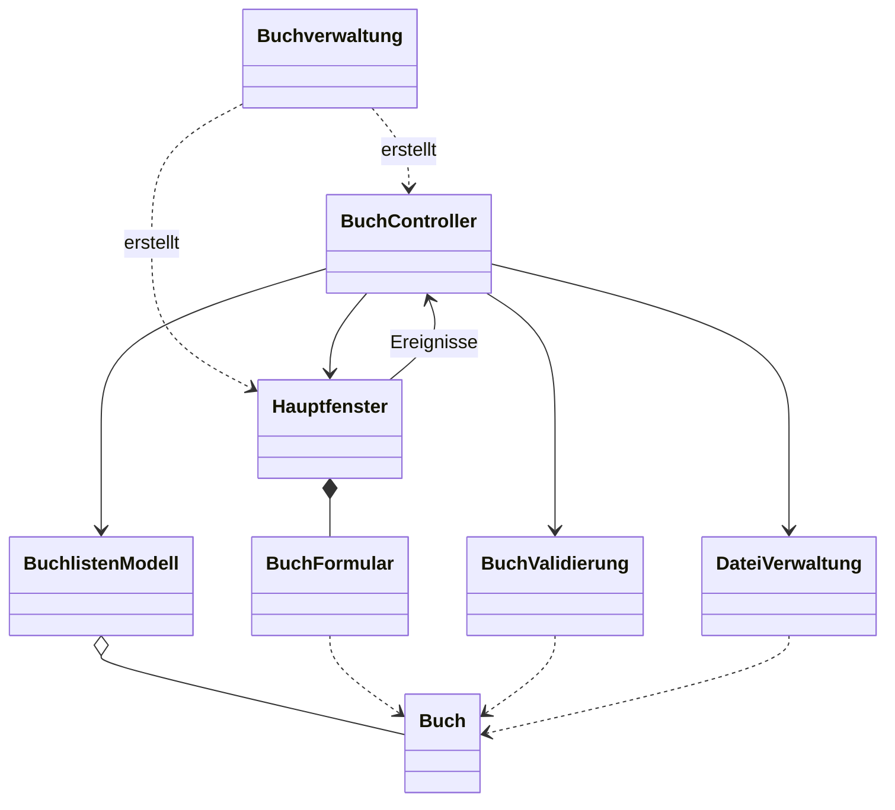

# Buchverwaltung

Java-Swing-Anwendung zur Verwaltung von Büchern. Das Projekt enthält bisher nur das
Grundgerüst; die mit `TODO` markierten Funktionen sind noch nicht implementiert.

## Projekt öffnen

In Apache NetBeans den Ordner `Buchverwaeltung` öffnen.
Voraussetzungen: **OpenJDK 21**, Zeichensatz **UTF-8**.

## Aufbau

| Klasse | Aufgabe |
| --- | --- |
| `Buchverwaltung` | Programmeinstieg |
| `Buch` | Daten eines Buches |
| `BuchlistenModell` | Buchsammlung verwalten |
| `BuchValidierung` | Buchdaten prüfen |
| `BuchController` | Benutzeraktionen koordinieren |
| `Hauptfenster` | Hauptfenster mit Buchliste |
| `BuchFormular` | Eingabe und Bearbeitung der Buchdaten |
| `DateiVerwaltung` | Bücher in einer Datei speichern und laden |

## Klassendiagramm

## Geplante Funktionen

- Alle Bücher anzeigen
- Bücher hinzufügen, bearbeiten und entfernen
- Alle Bücher speichern und aus einer Datei laden
